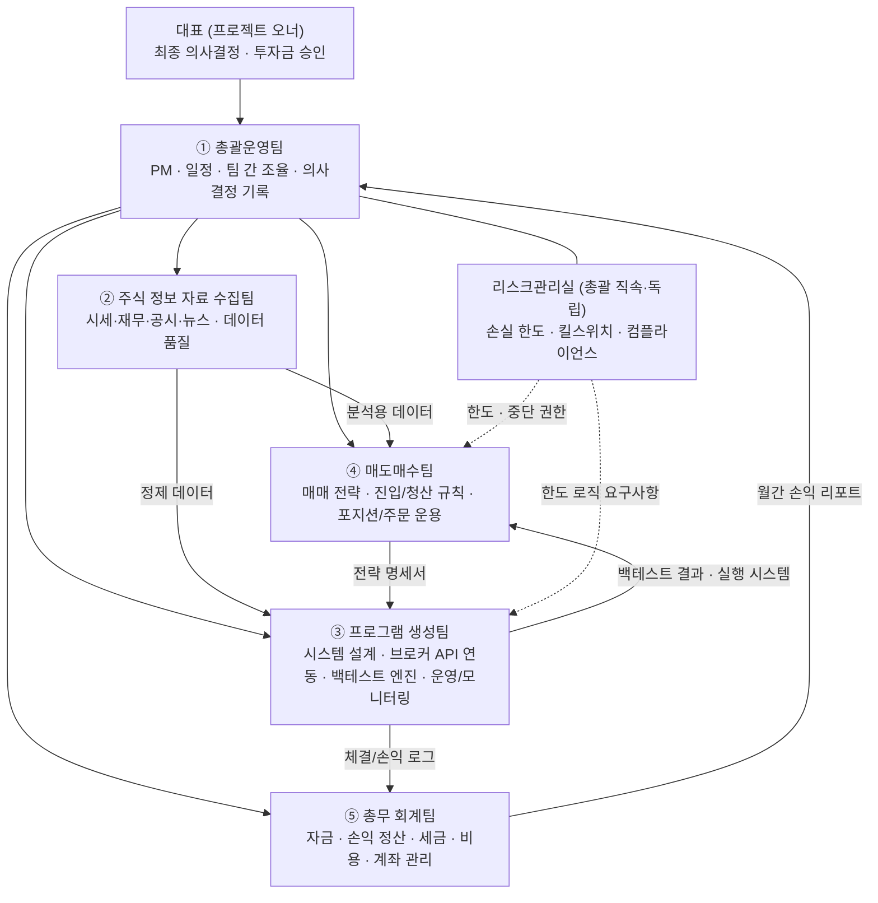

# 나는야 주식왕 — 조직도 및 운영 체계 (v0.1 초안)

> 상태: **v0.1 — 대표 승인 완료 (2026-11-23)**
> 작성: 총괄운영팀 / 2026-11-23

---

## 1. 조직 설계 원칙 (여의도 20년 경험에서 나온 원칙)

1. **매매와 리스크는 분리한다.** 돈을 버는 조직(매도매수팀)이 스스로 손실 한도를 정하고 감시하면 반드시 무너진다. 리스크관리는 총괄 직속의 독립 기능으로 둔다.
2. **데이터 → 전략 → 시스템 → 집행 → 정산**의 흐름이 끊기지 않게 팀 사이 인터페이스(무엇을 넘겨주는지)를 문서로 고정한다.
3. **모의투자 통과 전에는 실계좌에 1원도 넣지 않는다.** 백테스트 → 모의투자 → 소액 실전 → 증액의 단계를 반드시 밟는다.
4. **모든 결정은 기록한다.** 결정 사항은 `docs/DECISIONS.md`에 남기고, 팀 간 요청은 문서/이슈로 주고받는다.

---

## 2. 조직도

**제안 사항:** 요청하신 5개 팀은 그대로 유지하고, **리스크관리실을 총괄운영팀 직속의 독립 조직으로 추가**할 것을 권합니다. (별도 창을 띄우지 않고 총괄운영팀 창에서 겸임 운영 가능)

---

## 3. 팀별 역할과 책임 (R&R)

| 팀 | 핵심 미션 | 주요 업무 | 핵심 산출물 |
|---|---|---|---|
| ① 총괄운영팀 | 프로젝트를 일정·품질·리스크 안에서 굴러가게 한다 | 로드맵·마일스톤 관리, 팀 간 조율, 주간 회의, 의사결정 기록, 단계 전환(모의→실전) 승인 | 로드맵, 주간 보고, `DECISIONS.md` |
| 리스크관리실 | 계좌가 한 번에 망가지는 일을 막는다 | 일·주·월 손실 한도, 종목/섹터 비중 한도, 킬스위치 규칙, 법규·약관 점검 | 리스크 정책서, 한도표, 사고 대응 매뉴얼 |
| ② 자료 수집팀 | 믿을 수 있는 데이터를 제때 공급한다 | 데이터 소스 선정(증권사 API, KRX, DART 등), 수집 파이프라인 요구사항, 결측·수정주가·상장폐지 처리, 데이터 사전 | 데이터 소스 목록, 데이터 사전, 품질 점검 리포트 |
| ③ 프로그램 생성팀 | 전략을 안전하게 자동 실행하는 시스템을 만든다 | 아키텍처, 증권사 API 연동, 백테스트 엔진, 주문 모듈, 로그/알림, 배포·장애 대응 | 시스템 설계서, 코드, 테스트, 운영 매뉴얼 |
| ④ 매도매수팀 | 수익이 나는 매매 규칙을 만들고 운용한다 | 전략 아이디어·가설, 진입/청산/손절 규칙, 포지션 사이징, 백테스트 결과 해석, 실전 운용 일지 | 전략 명세서, 백테스트 평가 리포트, 매매 일지 |
| ⑤ 총무 회계팀 | 돈의 흐름을 정확히 기록하고 지킨다 | 투자 원금·추가 입금 관리, 일/월 손익 정산, 수수료·세금 계산, 인프라 비용 관리, 장부 | 손익 장부, 월간 결산, 세금 메모 |

---

## 4. 의사결정 권한표 (RACI 요약)

R = 실행, A = 최종 승인, C = 협의, I = 공유

| 의사결정 | 대표 | 총괄 | 리스크 | 자료 | 프로그램 | 매매 | 회계 |
|---|---|---|---|---|---|---|---|
| 투자 원금·증액 | **A** | R | C | | | C | C |
| 증권사/API 선정 | I | **A** | C | C | R | C | C |
| 데이터 소스 선정 | | **A** | | R | C | C | C(비용) |
| 매매 전략 채택 | I | **A** | C | C | C | R | |
| 손실 한도·킬스위치 | **A** | C | R | | C | C | I |
| 모의 → 실전 전환 | **A** | R | C | I | C | C | I |
| 긴급 매매 중단 | I | I | **A/R** | | R | R | I |

> 긴급 중단은 리스크관리실·프로그램팀·매매팀 누구나 즉시 실행할 수 있고, 사후 보고한다.

---

## 5. 단계별 로드맵 (초안)

| 단계 | 내용 | 통과 기준 (Gate) |
|---|---|---|
| **P0. 착수** | 조직 확정, 증권사/API 결정, 리스크 정책 초안 | 대표 승인 |
| **P1. 기반 구축** | 데이터 수집, 백테스트 엔진, 첫 전략 1~2개 명세 | 데이터 품질 리포트 통과 |
| **P2. 백테스트** | 최소 5년 이상 기간, 수수료·세금·슬리피지 반영 | 리스크·매매·총괄 3자 검토 통과 |
| **P3. 모의투자** | 증권사 모의투자 계좌로 최소 4~8주 운용 | 백테스트 대비 괴리 허용 범위 이내, 시스템 무장애 |
| **P4. 소액 실전** | 대표가 정한 소액으로 실계좌 운용 | 손실 한도 미위반, 정산 일치 |
| **P5. 증액·확장** | 단계적 증액, 전략 추가 | 대표 승인 |

---

## 6. 운영 방식 (팀별 창 운영 규칙)

- 각 팀은 **별도 세션(창)** 에서 운영하고, 작업 결과는 이 저장소의 `teams/<팀폴더>/`에 문서로 남긴다.
- 팀 간 요청·전달은 `teams/<받는팀>/INBOX.md`에 적거나 GitHub 이슈로 남긴다. 구두(채팅) 합의는 효력이 없다.
- 이 방(총괄운영팀)은 주기적으로 각 팀 산출물을 취합해 `docs/DECISIONS.md`와 로드맵을 갱신한다.
- 각 팀 창의 첫 지시문(킥오프 프롬프트)은 `teams/<팀폴더>/CHARTER.md` 하단에 있다.

| 폴더 | 팀 |
|---|---|
| `teams/01-hq` | 총괄운영팀 (+ 리스크관리실) |
| `teams/02-data` | 주식 정보 자료 수집팀 |
| `teams/03-dev` | 프로그램 생성팀 |
| `teams/04-trading` | 매도매수팀 |
| `teams/05-finance` | 총무 회계팀 |
