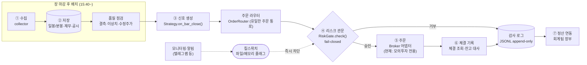

# 시스템 아키텍처 초안 (1차 과업 #2, #3)

> 작성: 프로그램 생성팀 / 2026-11-23 · 상태: 초안 v0.1

## 1. 전체 흐름

| 단계 | 모듈 (`src/stockking/`) | 상태 |
|---|---|---|
| ① 수집 | `data/` (일봉 CSV 로더·검증) | MVP — 자료수집팀 소스 확정 후 수집기 구현 |
| ② 저장 | 파일(CSV/Parquet) → 필요시 SQLite/DuckDB | 설계만 |
| ③ 신호 | `strategy/` (인터페이스 + 검증용 예제) | MVP |
| ④ 리스크 | `risk/gate.py` | **구현·테스트 완료** (한도 수치는 임시값) |
| ⑤ 주문 | `execution/router.py`, `broker/paper.py`, `broker/kis.py` | 라우터·로컬모의 완료, KIS 모의 어댑터 부분 구현 |
| ⑥ 체결 | `audit/journal.py` | 감사 로그 완료, 체결조회/대사 미구현 |
| ⑦ 정산 | 감사 로그 → 회계팀 장부 포맷 변환 | 회계팀 양식 수령 후 |
| 백테스트 | `backtest/` | **MVP 완료** |

## 2. 하루 운영 스케줄 (KST, 모의투자 단계)

| 시각 | 작업 |
|---|---|
| 08:00 | 헬스체크(토큰 발급, 잔고 조회, 킬스위치 상태, 디스크) → 이상 시 알림·당일 거래 중단 |
| 08:30 | 전일 신호 → 주문 후보 확정, 리스크 관문 사전 점검(드라이런) |
| 09:00~09:10 | 시가 주문 집행 (백테스트 가정과 동일하게 "D+1 시가") |
| 장중 | 체결 조회 폴링, 손실 한도 감시, 이상 시 킬스위치 |
| 15:30 | 장 마감 |
| 15:40~ | 데이터 수집·품질점검 → 신호 생성 → 다음날 주문 후보 저장 |
| 16:30 | 잔고 대사(증권사 잔고 vs 시스템 장부) → 불일치 시 다음날 거래 중단 + 회계팀 통보 |

## 3. 리스크 관문 = 주문 직전 필수 관문 (과업 #3)

**구조적 강제 장치**
1. 전략은 `TargetOrder`(의도)만 반환한다. 브로커 객체를 받지 못한다.
2. `OrderRouter`만 브로커를 갖고, `submit()` 안에서 `RiskGate.check()`가 승인해야만 `broker.place_order()`가 호출된다.
3. 백테스트 엔진도 **동일한 `RiskGate`** 를 쓴다 → 백테스트와 실전의 규칙 차이로 인한 괴리 제거.
4. **Fail-closed**: 현재가 없음, 계산 예외, 평가금 0 → 전부 거부.
5. `OrderRouter`는 `is_paper=True` 브로커가 아니면 생성 자체를 거부, `config.resolve_mode("live")`는 예외.

**검사 항목 (순서대로, `RiskLimits` 수치는 리스크관리실 확정 전 임시값)**

| # | 검사 | 임시값 | 위반 시 |
|---|---|---|---|
| 0 | 킬스위치 | — | 신규 매수 차단, 보유 수량 이내 청산 매도는 허용(D-026) |
| 1 | 중복 주문번호(멱등) | — | 거부 |
| 2 | 주문 속도 | 분당 10건 | 거부 (폭주 루프 방지) |
| 3 | 시장가 (리스크실 결정 2026-11-24) | 국내 청산 매도만 허용(X_STOP/X_TP/X_TIME/X_ADMIN/X_KILL, 점검용 X_TECH), 국내 매수·미국은 지정가만 | 거부 |
| 4 | 기준가 ±가격제한폭 | ±30% | 거부 (팻핑거) |
| 5 | 손실 한도 (D-028, `risk/stages.py`) | 일 −5%(T0)/−3%(T1~), 주 −8%, 원금 −20% 최종 손절 | 일·최종: **킬스위치 발동**, 주: 신규매수 차단. 최고점 −15%는 사이징 50% 축소 |
| 5-1 | 1건 손실 (D-028) | 손절가까지 손실 ≤ 총자산 2% (`stop_price`) | 거부. 손절가 ≥ 매수가도 거부 |
| 5-2 | D-005 주문 크기 / 1주 예외 (D-021·D-025·D-036) | `order_target` 의 90~110%. 못 맞추면 1주 예외: 1주 가격 ≤ 30%, '목표 초과' 예외 동시 1개('목표 미달'은 제외), 손절가 필수 | 거부. 예외 신규 1주는 비중 한도 30% 적용 |
| 6 | 1회 주문 금액 | 200만원 | 거부 |
| 7 | 예수금 (미수 금지) | — | 거부 |
| 8 | 1종목 비중(주문 후) | 22% (D-005), 1주 예외 신규 진입은 30% (D-025) | 거부 |
| 9 | 동시 보유 종목 수 | 5 | 거부 |
| 10 | 공매도 금지 | — | 보유 초과 매도 거부 |

**킬스위치**
- 발동: 누구나 `touch var/KILL_SWITCH` (리스크·프로그램·매매팀 즉시 실행 권한, ORGANIZATION.md §4), 또는 일 손실 한도 자동 발동
- 해제: 원인 확인 후 **사람이 수동으로만** (`KillSwitch.reset(operator=...)`, 해제자 기록 필수)
- 백테스트는 메모리 전용 킬스위치를 써서 운영 킬스위치 파일과 절대 간섭하지 않음

## 4. 보안 (API 키)

- 비밀값은 환경변수/`.env`(gitignore)로만 주입. 템플릿은 `.env.example`.
- `Secret` 래퍼로 repr/로그 노출 차단, 감사 로그는 `appkey/appsecret/authorization/token` 키를 자동 마스킹.
- 모의투자 키와 실전 키는 **변수명부터 분리**(`KIS_PAPER_*`). 실전 키는 승인 전까지 서버에 존재하지 않아야 함.
- CI 안전망: `tests/test_no_secrets_committed.py` (추적 파일에서 `.env`/키 패턴 검사).
- 운영 서버 단계에서는 OS 키체인 또는 클라우드 Secret Manager로 이관 권고.

## 5. 실전 전환 시 해야 할 일 (지금은 하지 않음)

`config.LIVE_TRADING_APPROVED`는 상수로 `False` 고정. 해제 조건:
1. P3 모의투자 Gate 통과 + 대표 승인 결정번호가 `docs/DECISIONS.md`에 기록
2. 실전 어댑터 별도 클래스 작성(모의 클래스 재사용 금지) + 리스크실 한도 확정값 반영
3. 코드 리뷰 2인(프로그램팀 + 리스크실) 후 머지
